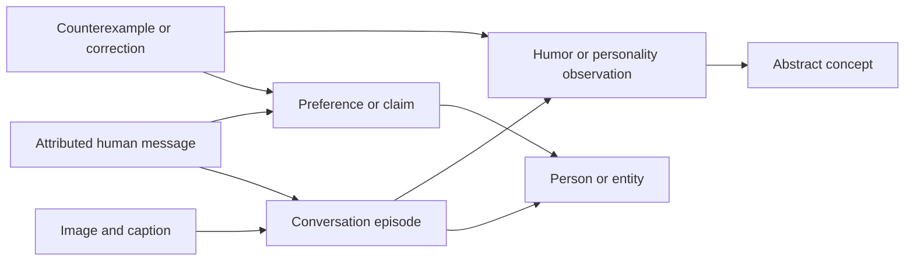

# Living memory graph

2.27.0 H77 is deployed;2.27.1completes the observed own-history boundary. Ordinary
recognized follow-ups retain one complete immediate human setup for abstract lookup.
Explicit requester-history questions retain only that authenticated human's current
conversation/focus rows, excluding old bot answers, peers and detached references.
The original request and source checks remain authoritative. Four matched private
Discord posts reproduce borrowed bot history in both baseline cases and correct
both with the candidate, including a retained fictional same-author premise.
All six feature gates pass:1,301tests/96.94%coverage/31typed modules/build.2.27.1
release and fresh installed gateway acceptance follow. Broader fidelity is unproven.
[Both planning phases and actual limits](evaluations/2026-10-16-memory-continuity-study.md).

Native factual packets can vary under bounded fresh reads and safely suppress a draft,
observed before and after H77. H78 root-cause/verification scheduling is unresolved;
preserve the final guard. This materially affects delivery and takes diagnostic
priority before more population. Then qualified applicability/human-held-out benefit,
linked native/original pixels, selective skills/tools and generated Michigan U.P.
aurora/trail-camera scenes with short captions and generated provenance. H66 remains
open, and new material privacy/grounding evidence can change order again.

Earlier 2.26.8 deployed via [PR127](https://github.com/jdegregorio/wcb-discord-bot/pull/127).
H76 keeps reviewed aliases on current observation-concept relationships, so shared
memory growth preserves older discovery paths. Installed actual handler validates
import, retirement and source removal, provider0; all24existing alias results match.
All gates/CI/both images pass:1,252tests/96.92%coverage/31source hashes. Fresh normal
gateway8/8core cases, no broad fidelity or humor-gain claim. H74 emotion population
is rejected (6/6opportunity and6/6controls each arm), H72 stays rejected. No new
human observation ships. Prioritize applicability and qualified candidates with a
reproduced deficit, then linked native/original pixels and selective tools/generated
U.P. scenes. H66 remains open. [Study](evaluations/2026-10-15-emotional-memory-study.md),
[installed evidence](evaluations/2026-10-15-concept-alias-release.json).

2.26.7 deployed via [PR125](https://github.com/jdegregorio/wcb-discord-bot/pull/125).
H73 requires conditional, separated-source qualification for every pattern domain
at import and again at lookup, describe and sweep. Actual private Discord handler:
baseline admits the unqualified synthetic pattern; installed code rejects the
import and excludes a restored legacy fixture. Qualified memory remains usable.
All six feature/merged gates, CI and both images pass: 1,234 tests, 96.94% coverage.
Fresh normal gateway passes 7/8 strict cases, with unsupported broad-year inference
still open; current old/new graph packets match for that graph-bypassing route.
H72 population is rejected: conservative final humor scores 6/7 in each arm, with
no clear gain. No new human trait or provider pass ships. Qualified population is
next, then applicability/care/humor, linked native/original pixels and selective
tools/generated U.P. scenes. [Study](evaluations/2026-10-15-abstract-humor-study.md) and [installed evidence](evaluations/2026-10-15-abstract-humor-release.json).

Prior 2.26.6/PR123 added: source/author scope is rechecked after generation and
before publication, protecting correction/withdrawal during richer memory use.
Installed guards5/5; normal gateway8/9 strict cases leaves weak invited humor open.
No new graph observation or native semantic permission. Qualified abstraction
population/legacy review is next, followed by applicability/care/semantic humor,
broader linked native/original pixels and selective tools/generated U.P. scenes.
[Final installed evidence](evaluations/2026-10-15-reply-source-freshness-release.json).

Prior 2.26.5 was deployed and verified via [PR121](https://github.com/jdegregorio/wcb-discord-bot/pull/121),
runtime commit 0b609af. Ordinary authored recall omits adjacent Slack text and competing
optional voice examples while retaining complete authored paragraphs and provenance.
Context/joke/explanation/quote/evidence requests retain setup; native episodes and
qualified abstract memory remain unchanged. No new provider pass or service.

All six feature and actual merged gates pass: 1,167 tests, 96.87% branch coverage,
31 typed modules/build; required CI and both immutable image architectures succeed.
Installed 31 source hashes/versions/prototype packet match, private scope and graph
lifecycle pass. Actual normal gateway: 10/11 semantic passes: both changed recall
questions pass; retained-context wording flattens a source question into an assertion.
That unchanged route remains OPEN. No routine metadata disclaimer, general fidelity
or measured humor multiplier claimed. Short health window has zero errors/restarts.

[Both planning phases and study](evaluations/2026-10-15-authored-recall-study.md) and [structured installed result](evaluations/2026-10-15-authored-recall-release.json)
record the narrow comparison, source limits, remaining failure and spending evidence.

H62/H62a2.25.0 supplies reviewed rollout preview plus one qualified conditional
abstraction;H632.26.0 preserves whole conflict components as memory grows;
H682.26.2 preserves complete stored authored passages or wholly omits them.
These do not establish broad character/humor improvement. Exact source evidence
and derived personal observations stay private, with full lifecycle and 18/2/20guard.

Joe requested an interconnected living memory system on 2026-10-07. Its operational
milestones and delivery boundaries follow; the current priorities are listed above.

## Current state and delivery boundary

Version 2.6.0 implements the first private operational graph on the existing
app volume. It connects source references, episodes, captured images, the pinned
person, reviewed claims/preferences, and concepts. Bounded traversal selects raw
supporting passages even when a question uses different words. Every observation
carries evidence fingerprints, source dates or explicit unknown dates, extraction
provenance, confidence basis, status, and optional expiry.

Initial population covers 439 eligible target text sources, 115 captured visual
episodes and 96 original image hashes. A 24-exchange private contextual study
retained one qualified claim with three sources after strict review. Other
proposed interpretations were rejected. Captured images are linked but marked
unstudied; they do not yet establish historical visual interpretations or beliefs.
Version 2.7.0 adds continuous bounded text extraction with a separate contextual
review, source-driven checkpoint invalidation and operator retirement. Peer nodes,
real reply/thread relationships, broader entities and evaluated humor/style
observations remain further increments. Read progress.md for actual rollout state.

The automation runs six standalone tasks daily at 01:00, 05:00, 09:00, 13:00,
17:00 and 21:00 Pacific. Each run uses a fresh managed worktree, inspects prior
progress and open PRs, and completes one coherent improvement. See progress.md
for actual release and deployment status, rather than treating a candidate as live.

## Graph model

Store graph state privately on the existing app volume. Start with indexed
SQLite nodes, edges, source links and extraction checkpoints. A graph is the
interconnected data model; it does not require an additional hosted graph service.
Keep raw source stores lossless and authoritative. Add a graph store/schema only
with explicit migration, withdrawal, correction, backup and rollback behavior.

| Node | Meaning |
| --- | --- |
| Human source message | Attributed original text, timestamps or explicit unknown dates, source reference |
| Bot reply | Fallible conversational context, excluded as support for personal beliefs |
| Visual source | Captured pixels, caption, source reference, hashes and missing/partial-frame status |
| Conversation episode | Setup, actual reply/thread links, reactions and separately flagged adjacency |
| Person/entity | Verified person or cautiously resolved team, player, place, activity or recurring topic |
| Claim/preference | A distilled proposition with supporting and conflicting sources, temporal validity and status |
| Style/humor observation | An evidence-backed pattern, its conversational conditions and counterexamples |
| Concept | Recurring themes, relationships, interests and abstract ideas connected to episodes and observations |

Use typed relationships such as authored-by, replies-to, part-of, depicts,
mentions, about, supports, contradicts, supersedes, exemplifies and conditioned-on.
Keep a distinction between a repeated phrase, a recurring joke and an enduring
preference. A single sarcastic line cannot establish a literal belief. Personality
and humor observations describe evidence and context, rather than declaring
immutable psychological facts.

Every derived node/edge must carry source links, extraction version, confidence
basis, observed time, source time or unknown-date marker, and active/tentative/
contested/superseded/invalid status. Confidence is a supported judgment with
evidence, not an uncalibrated model probability. Multiple copies of one export or
overlapping excerpts do not become independent corroboration.

## Milestone 1: usable graph recall

Build and populate typed nodes/edges from the existing verified sources, with
resumable checkpoints and a narrow set of source-backed concepts. Wire bounded
graph traversal into responses, combined with source text retrieval. Demonstrate
that a relevant entity or concept can reach an older supporting episode even
when the question uses different wording. Preserve source evidence in the
selected subgraph and refresh native source material before use.

Acceptance requires direct, reaction and follow-up replies using supported
memory; a changing or contradictory preference; an image-dependent reference;
an unsupported bot/peer claim; source edit/delete; withdrawal with a loaded
graph client; interrupted extraction/restart; and a query outside the source
guild. Measure useful recall, precision, response latency, selected-context size
and accounted cost. Use private expectations and held-out/synthetic exchanges.
Do not hardcode real personal preferences into public code or fixtures.

## Milestone 2: continuous distillation and correction

Incrementally derive claims, entities and context-dependent humor/style
observations from newly ingested conversations and historical study batches.
Jobs must be bounded and resumable, and must use the existing maintenance ledger.
Separate observed words, visual interpretation and inferred conclusions.
Include multiple support sources, counterexamples and explicit ambiguity.
Route ingestion, edits, deletion, suppression and source pruning into graph
invalidation. Recompute affected derivations without resurrecting removed text.
A withdrawal marker must block graph clients and restored graph backups while
leaving spending accounting intact.

## Milestone 3: depth and coverage

Extend native historical retention/context deliberately, preserving peer setup,
reply/thread links, relevant reactions and original images. Respect source and
recipient visibility when retrieving across channels. Track channel/date/source
coverage, denied access, unknown dates, missing pixels and unstudied episodes.
Study abstract humor patterns and relationships with held-out contextual tests.
Use relevant graph neighborhoods, lexical retrieval and semantic retrieval where
measured benefit justifies it, rather than loading the whole corpus into replies.

Report the first operational graph separately from complete historical coverage
and improved character fidelity. No milestone alone proves an indistinguishable
digital twin. Continue to measure the actual replies.

2.11.0 adds ephemeral source-linked native neighborhoods to replies, verified
through installed source probes and actual owner-authored Discord messages.
It does not populate peer nodes or reply/thread edges in the durable graph.
Continuous context-qualified derivation and broader native/visual coverage remain
separate milestones; the graph retains its existing fingerprints and withdrawal.

2026-10-10 13:00: select H21a conditional episode abstraction storage/retrieval,
with linked counterexamples and authoritative source invalidation. H22 creative
amplification remains next, then contextual native/visual coverage, selective
skills/tools and generated outdoor scenes. Behavioral benefit is prospective;
see research.md for locked acceptance, dependencies and operating impact.

## Human focus for imaginative follow-ups (2.12.1)

Inferred follow-ups can carry at most 600 characters from the immediately
preceding human setup. Typed conversation, memory, reference and focus origins
prevent retrieved evidence or detached older messages from supplying that topic.
Intervening human chat disables the anchor. The latest question and image pixels
remain focused, recipient judgment remains separate, and added context is reserved
in the existing spending ledger. No extra request, source scope, state or model.

Explicit hypothetical choices may be made conditionally without evidence of
Andrew's actual favorite. Such choices never become human facts. All source,
withdrawal, recipient and emotional rules remain. Amplified humor prototypes
failed their research criteria and are not included. Conditional episode storage
from merged #62 is included as enabling code; its selected private pattern is
still offline and its behavioral study remains open.

### Behavioral domains, 2.14.0

Conditional value/emotion/relationship memories share humor/style corroboration,
separation, counterevidence, review, expiry and invalidation. Values describe
observed priorities; emotions describe expressed responses; relationships describe
observed interaction patterns. Never infer motives, mental health or private intimacy.
New types require abstraction fields even for operator imports. Population and
human held-out fidelity remain separate milestones; do not equate schema coverage
with a complete personality graph. Checkpoint cohort and pacing are unchanged.

## H55a native setup links

Existing native reply retrieval now records content-free source-to-context links in
memory-graph.sqlite3. At most100 captures/up to five human dependencies each/30-day
capture lifetime, plus the native source retention floor. Speaker/channel/message
IDs, source/capture timestamps, reply relations, full text hashes, media-presence
markers and coverage gaps remain private. Original pixels are not represented by
these hashes, and no peer text or derived human interpretation is persisted.

Shared learning-lock checks reject raced captures. Known peer edits/deletes and
source changes erase links and graph backups; current target-neighbor rows also
block stale restored metadata after correction. Missing graph/denied setup reads
leave ordinary replies available. Withdrawal erases this graph state and preserves
the spending ledger. No schema migration, source replay or new provider/Discord
request. Optional metadata comes from the existing live collector, not a new intake.

A capture records observed bounded setup, not current visibility or complete context.
The automatic native pattern gate remains closed. H55b must add fresh per-dependency
reads before studies/both provider passes/commit, full contextual packets and held-out
validation before opening it. No new abstraction or measured reply-quality gain.
Rollback2.20.1 is schema-compatible and retains the pattern gate, but stops the new
capture lifecycle; sweep/remove native_context and orphan native_context_dependency
nodes with2.21.0 before a deliberate downgrade after capture. Do not restore source
or spending databases to roll back code. Synthetic smoke artifacts keep only
content-free refs/flags/public code under private app-volume0700/0600 and existing
seven-day manual retention/withdrawal cleanup; disposable databases are erased.

## Native dependency freshness, 2.22.1

H56 freshly reads the retained focus and every dependency, returns complete bounded
human setup only ephemerally, and repairs missed edits/deletes/access loss through the
existing learning worker. At most two captures/six HTTP reads/six seconds per cycle.
Stored captures remain last-observed metadata; no fresh visibility certificate is
persisted. Reads are not an atomic Discord snapshot or proof of complete setup.
Automatic native patterns remain gated. H55b must wire identical context into both
provider passes/commit, derived context invalidation and held-out human validation.
This is a prerequisite, not a populated abstraction or a measured fidelity gain.

The2.22.1 correction uses one current bounded history page for retained dependency
IDs, plus an exact same-channel parent read if needed. Freshness/attribution checks
still apply to every dependency. No new neighbors enter learning/context; missing
nonparents erase obsolete captures without guessing message deletion. No preserved
freshness certificate or automatic native pattern permission. [Transport study](evaluations/2026-10-13-native-freshness-study.md).

## H58a native setup dependency lifecycle

2.23.0 binds existing content-free context captures to native studies and their
observations. Fresh reads at both attempts/commit and locked local checks reject
changes; derived retrieval/retirement follows context correction, removal and expiry.
Identical recapture preserves memory. This completes local dependency lifecycle,
not contextual semantic learning or abstract population. Native pattern gate remains
closed; target-only provider payloads unchanged. Specific peer-context transfer approval
and genuine human-held-out qualification remain prerequisites for H55b/H48.
