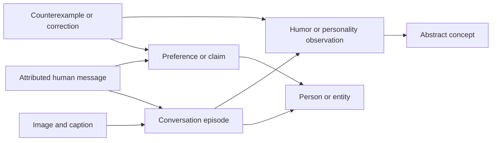

# Living memory graph

H68 is delivered in 2.26.2. Complete stored authored passages up to 6,000 UTF-8
bytes retain closing meaning; larger passages and adjacent context are omitted
wholly with an internal gap. All six feature/merged gates pass: 1,118 tests, 96.87%
branch coverage, 31 typed modules and package builds. Required PR/main CI and both
images pass. Installed versions and all 31 source hashes match; actual complete
and oversized private Discord handler cases pass. Primary Discord remains ready,
healthy with zero restarts. Current 405 archive blocks/34 native sources have no
affected long passage; all 439 baseline/candidate stored-source renderings match.
This is enabling integrity protection, not a general character-quality gain.

H66 remains OPEN and first: historical speaker/polarity synthesis, plus intermittent
requester ownership. Final normal gateway has nine owner probes/eight posts/one
abstention: the seven selected serial controls pass six, with historical attribution
failing. An earlier overlapped ownership answer also fails; its serial recheck
passes. The unchanged classifier misses a noun-phrase authored-history question.
Investigate this deterministic guard gap and source-linked factual planning with
matched/held-out validation; no current behavioral prototype qualified for shipping.
Then H48/H21/H28 qualified abstractions; H64/H22/H39/H51 applicability/care/semantic
humor; linked native/original pixels; H61 selective skills/tools and generated
Michigan U.P. aurora/trail-camera scenes with short natural captions and provenance.
Preserve the native pattern gate, source/date/withdrawal/privacy and 18/2/20 guard.

H63 is deployed and verified in 2.26.0: complete bounded graph retrieval survives
memory growth, preserving transitive conflicts and source lifecycle. All six
feature/merged gates pass1,107tests/96.86%/31modules; required PR/main/image CI and
both architectures succeed.31installed source hashes/OCI revision match; actual
installed owner-handler fixture keeps4observations versus0baseline. Nine existing
actual-anchor memory routes match; back-to-back source-read timeouts are a corrected
harness limitation, with20/20spaced fresh reads and unchanged freshness bounds.

Fresh normal gateway8cases/7posts/one abstention:7semantic passes, one historical
attribution failure. A peer stance is assigned to Andrew. Same-case first source
packets/provider requests are identical across baseline/candidate, with zero calls
to the changed selector; final baseline passes, candidate fails. Earlier baseline
also exhibits a different content-grounding error. This is an existing synthesis
vulnerability; do not claim every recall case passes or a measured general fidelity
gain. H66 author-constrained historical synthesis is now first, ahead of H48 population.
Stock care and familiar humor remain unresolved. No rollback can change a selector
that the failed route does not execute; the scoped H63 increment remains healthy.
[Final study](evaluations/2026-10-14-graph-selection-study.md) and [installed evidence](evaluations/2026-10-14-graph-selection-release.json).

Next: H66 grounding correction with adversarial peer/polarity cases and held-out/
actual Discord validation; H48/H21/H28 independent qualified abstractions/legacy
review; H64 applicability plus H22/H39/H51 care/semantic humor/cues; broader native
linked context/original pixels; H61 selective tools/generated U.P. scenes. H55b
specific semantic-transfer approval remains unresolved and native automatic patterns
closed. Preserve source/author/correction/withdrawal/privacy and shared18/2/20 guard;
no source intake, model, service, study pacing, schedule or notification change.

H62/H62a 2.25.0 supplies safe reviewed rollout preview and one operational private
conditional abstraction with support, contrary evidence, tentative status and expiry.
Matched actual handlers and ten installed normal gateway cases pass; broad character/
humor gain is unmeasured. Continue independent abstract population/legacy qualification,
then emotional/semantic humor/cue trials, wider native/visual context and selective
skills/tools/generated U.P. aurora/trail-camera sharing. Native semantic peer-transfer
permission remains unresolved and automatic native patterns stay closed. Source-text
quotes and narrow date lookup remain secondary. See current plan/backlog and H62 study.

Joe requested an interconnected living memory system on 2026-10-07. This is the
next architectural priority, rather than another isolated prompt patch.

## Current state and delivery boundary

Version 2.6.0 implements the first private operational graph on the existing
app volume. It connects source references, episodes, captured images, the pinned
person, reviewed claims/preferences, and concepts. Bounded traversal selects raw
supporting passages even when a question uses different words. Every observation
carries evidence fingerprints, source dates or explicit unknown dates, extraction
provenance, confidence basis, status, and optional expiry.

Initial population covers 439 eligible target text sources, 115 captured visual
episodes and 96 original image hashes. A 24-exchange private contextual study
retained one qualified claim with three sources after strict review. Other
proposed interpretations were rejected. Captured images are linked but marked
unstudied; they do not yet establish historical visual interpretations or beliefs.
Version 2.7.0 adds continuous bounded text extraction with a separate contextual
review, source-driven checkpoint invalidation and operator retirement. Peer nodes,
real reply/thread relationships, broader entities and evaluated humor/style
observations remain further increments. Read progress.md for actual rollout state.

The automation runs six standalone tasks daily at 01:00, 05:00, 09:00, 13:00,
17:00 and 21:00 Pacific. Each run uses a fresh managed worktree, inspects prior
progress and open PRs, and completes one coherent improvement. See progress.md
for actual release and deployment status, rather than treating a candidate as live.

## Graph model

Store graph state privately on the existing app volume. Start with indexed
SQLite nodes, edges, source links and extraction checkpoints. A graph is the
interconnected data model; it does not require an additional hosted graph service.
Keep raw source stores lossless and authoritative. Add a graph store/schema only
with explicit migration, withdrawal, correction, backup and rollback behavior.

| Node | Meaning |
| --- | --- |
| Human source message | Attributed original text, timestamps or explicit unknown dates, source reference |
| Bot reply | Fallible conversational context, excluded as support for personal beliefs |
| Visual source | Captured pixels, caption, source reference, hashes and missing/partial-frame status |
| Conversation episode | Setup, actual reply/thread links, reactions and separately flagged adjacency |
| Person/entity | Verified person or cautiously resolved team, player, place, activity or recurring topic |
| Claim/preference | A distilled proposition with supporting and conflicting sources, temporal validity and status |
| Style/humor observation | An evidence-backed pattern, its conversational conditions and counterexamples |
| Concept | Recurring themes, relationships, interests and abstract ideas connected to episodes and observations |

Use typed relationships such as authored-by, replies-to, part-of, depicts,
mentions, about, supports, contradicts, supersedes, exemplifies and conditioned-on.
Keep a distinction between a repeated phrase, a recurring joke and an enduring
preference. A single sarcastic line cannot establish a literal belief. Personality
and humor observations describe evidence and context, rather than declaring
immutable psychological facts.

Every derived node/edge must carry source links, extraction version, confidence
basis, observed time, source time or unknown-date marker, and active/tentative/
contested/superseded/invalid status. Confidence is a supported judgment with
evidence, not an uncalibrated model probability. Multiple copies of one export or
overlapping excerpts do not become independent corroboration.

## Milestone 1: usable graph recall

Build and populate typed nodes/edges from the existing verified sources, with
resumable checkpoints and a narrow set of source-backed concepts. Wire bounded
graph traversal into responses, combined with source text retrieval. Demonstrate
that a relevant entity or concept can reach an older supporting episode even
when the question uses different wording. Preserve source evidence in the
selected subgraph and refresh native source material before use.

Acceptance requires direct, reaction and follow-up replies using supported
memory; a changing or contradictory preference; an image-dependent reference;
an unsupported bot/peer claim; source edit/delete; withdrawal with a loaded
graph client; interrupted extraction/restart; and a query outside the source
guild. Measure useful recall, precision, response latency, selected-context size
and accounted cost. Use private expectations and held-out/synthetic exchanges.
Do not hardcode real personal preferences into public code or fixtures.

## Milestone 2: continuous distillation and correction

Incrementally derive claims, entities and context-dependent humor/style
observations from newly ingested conversations and historical study batches.
Jobs must be bounded and resumable, and must use the existing maintenance ledger.
Separate observed words, visual interpretation and inferred conclusions.
Include multiple support sources, counterexamples and explicit ambiguity.
Route ingestion, edits, deletion, suppression and source pruning into graph
invalidation. Recompute affected derivations without resurrecting removed text.
A withdrawal marker must block graph clients and restored graph backups while
leaving spending accounting intact.

## Milestone 3: depth and coverage

Extend native historical retention/context deliberately, preserving peer setup,
reply/thread links, relevant reactions and original images. Respect source and
recipient visibility when retrieving across channels. Track channel/date/source
coverage, denied access, unknown dates, missing pixels and unstudied episodes.
Study abstract humor patterns and relationships with held-out contextual tests.
Use relevant graph neighborhoods, lexical retrieval and semantic retrieval where
measured benefit justifies it, rather than loading the whole corpus into replies.

Report the first operational graph separately from complete historical coverage
and improved character fidelity. No milestone alone proves an indistinguishable
digital twin. Continue to measure the actual replies.

2.11.0 adds ephemeral source-linked native neighborhoods to replies, verified
through installed source probes and actual owner-authored Discord messages.
It does not populate peer nodes or reply/thread edges in the durable graph.
Continuous context-qualified derivation and broader native/visual coverage remain
separate milestones; the graph retains its existing fingerprints and withdrawal.

2026-10-10 13:00: select H21a conditional episode abstraction storage/retrieval,
with linked counterexamples and authoritative source invalidation. H22 creative
amplification remains next, then contextual native/visual coverage, selective
skills/tools and generated outdoor scenes. Behavioral benefit is prospective;
see research.md for locked acceptance, dependencies and operating impact.

## Human focus for imaginative follow-ups (2.12.1)

Inferred follow-ups can carry at most 600 characters from the immediately
preceding human setup. Typed conversation, memory, reference and focus origins
prevent retrieved evidence or detached older messages from supplying that topic.
Intervening human chat disables the anchor. The latest question and image pixels
remain focused, recipient judgment remains separate, and added context is reserved
in the existing spending ledger. No extra request, source scope, state or model.

Explicit hypothetical choices may be made conditionally without evidence of
Andrew's actual favorite. Such choices never become human facts. All source,
withdrawal, recipient and emotional rules remain. Amplified humor prototypes
failed their research criteria and are not included. Conditional episode storage
from merged #62 is included as enabling code; its selected private pattern is
still offline and its behavioral study remains open.

### Behavioral domains, 2.14.0

Conditional value/emotion/relationship memories share humor/style corroboration,
separation, counterevidence, review, expiry and invalidation. Values describe
observed priorities; emotions describe expressed responses; relationships describe
observed interaction patterns. Never infer motives, mental health or private intimacy.
New types require abstraction fields even for operator imports. Population and
human held-out fidelity remain separate milestones; do not equate schema coverage
with a complete personality graph. Checkpoint cohort and pacing are unchanged.

## H55a native setup links

Existing native reply retrieval now records content-free source-to-context links in
memory-graph.sqlite3. At most100 captures/up to five human dependencies each/30-day
capture lifetime, plus the native source retention floor. Speaker/channel/message
IDs, source/capture timestamps, reply relations, full text hashes, media-presence
markers and coverage gaps remain private. Original pixels are not represented by
these hashes, and no peer text or derived human interpretation is persisted.

Shared learning-lock checks reject raced captures. Known peer edits/deletes and
source changes erase links and graph backups; current target-neighbor rows also
block stale restored metadata after correction. Missing graph/denied setup reads
leave ordinary replies available. Withdrawal erases this graph state and preserves
the spending ledger. No schema migration, source replay or new provider/Discord
request. Optional metadata comes from the existing live collector, not a new intake.

A capture records observed bounded setup, not current visibility or complete context.
The automatic native pattern gate remains closed. H55b must add fresh per-dependency
reads before studies/both provider passes/commit, full contextual packets and held-out
validation before opening it. No new abstraction or measured reply-quality gain.
Rollback2.20.1 is schema-compatible and retains the pattern gate, but stops the new
capture lifecycle; sweep/remove native_context and orphan native_context_dependency
nodes with2.21.0 before a deliberate downgrade after capture. Do not restore source
or spending databases to roll back code. Synthetic smoke artifacts keep only
content-free refs/flags/public code under private app-volume0700/0600 and existing
seven-day manual retention/withdrawal cleanup; disposable databases are erased.

## Native dependency freshness, 2.22.1

H56 freshly reads the retained focus and every dependency, returns complete bounded
human setup only ephemerally, and repairs missed edits/deletes/access loss through the
existing learning worker. At most two captures/six HTTP reads/six seconds per cycle.
Stored captures remain last-observed metadata; no fresh visibility certificate is
persisted. Reads are not an atomic Discord snapshot or proof of complete setup.
Automatic native patterns remain gated. H55b must wire identical context into both
provider passes/commit, derived context invalidation and held-out human validation.
This is a prerequisite, not a populated abstraction or a measured fidelity gain.

The2.22.1 correction uses one current bounded history page for retained dependency
IDs, plus an exact same-channel parent read if needed. Freshness/attribution checks
still apply to every dependency. No new neighbors enter learning/context; missing
nonparents erase obsolete captures without guessing message deletion. No preserved
freshness certificate or automatic native pattern permission. [Transport study](evaluations/2026-10-13-native-freshness-study.md).

## H58a native setup dependency lifecycle

2.23.0 binds existing content-free context captures to native studies and their
observations. Fresh reads at both attempts/commit and locked local checks reject
changes; derived retrieval/retirement follows context correction, removal and expiry.
Identical recapture preserves memory. This completes local dependency lifecycle,
not contextual semantic learning or abstract population. Native pattern gate remains
closed; target-only provider payloads unchanged. Specific peer-context transfer approval
and genuine human-held-out qualification remain prerequisites for H55b/H48.
